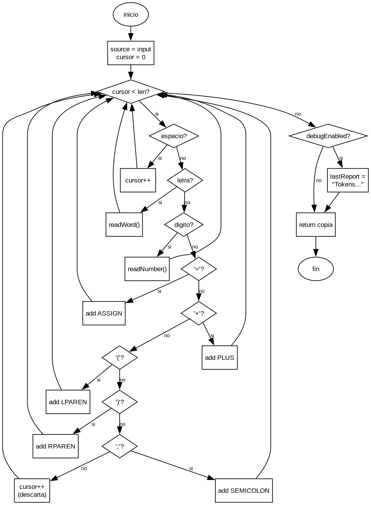
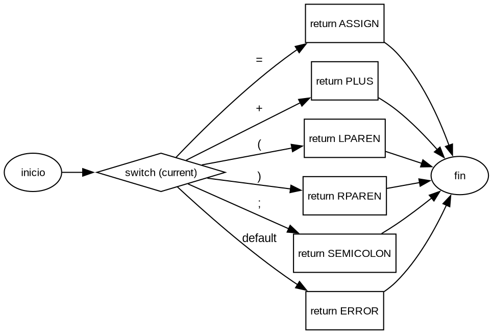

# Informe de laboratorio — Analizador léxico

**Integrante:** Paulo Araya
**Fecha:** 11 de noviembre de 2026
**IDE y Java:** Visual Studio Code, JDK 27 de Temurin, compilación `--release 17`.

## 1. Diagnóstico inicial

La versión inicial concentraba el estado de la tokenización en atributos de
instancia: `source`, `cursor` y `tokens`. `tokenize` recorría la entrada con una
cadena de ocho condiciones y delegaba palabras y números en `readWord` y
`readNumber`, que dependían del mismo estado mutable. Además, la clase incluía
responsabilidades ajenas (`debugEnabled`, `lastReport`, `enableDebug`,
`debugSummary`, `countCharacters`) y el conocimiento de las palabras reservadas
estaba duplicado entre `startsWith("let")` y `KeywordCatalog`. La arquitectura se
completaba con `LexicalReportService` y `TokenFormatter`, que separaban la
presentación, y con `DefaultKeywordCatalog` como implementación de la dependencia
inyectada.

De las diez pruebas obligatorias, cuatro pasaban en el estado inicial (01, 02,
06 y 08) y seis fallaban: clasificación por prefijo `let` (03), guion bajo no
reconocido como inicio de identificador (04), consumo de un solo dígito (05 y
07), descarte silencioso de caracteres inválidos (09) y acumulación de tokens
entre llamadas (10). La corrida completa contra el estado inicial, ya con las
pruebas implementadas, está en `docs/evidencia/test-inicial.log`: 17 ejecutadas,
10 fallos.

## 2. Pruebas automatizadas

| Test | Entrada | Esperado | Inicial | Final | Evidencia |
| --- | --- | --- | :---: | :---: | --- |
| 01 | `""` | lista vacía | pasa | pasa | `test01EmptyInput` |
| 02 | `let print` | `KEYWORD let@0`, `KEYWORD print@4` | pasa | pasa | `test02ExactKeyword` |
| 03 | `letter` | `IDENTIFIER letter@0` | falla | pasa | `test03IdentifierStartingWithLet` |
| 04 | `_total2` | `IDENTIFIER _total2@0` | falla | pasa | `test04IdentifierWithUnderscore` |
| 05 | `2026` | `INTEGER 2026@0` | falla | pasa | `test05MultiDigitInteger` |
| 06 | `=+();` | cinco símbolos en 0–4 | pasa | pasa | `test06Punctuation` |
| 07 | `let total = 12 + valor;` | los siete tokens de la guía | falla | pasa | `test07CompleteExpression` |
| 08 | `" \nprint ( x )"` | `print@2`, `(@8`, `x@10`, `)@12` | pasa | pasa | `test08WhitespaceAndPositions` |
| 09 | `abc@5` | `abc@0`, `ERROR @@3`, `INTEGER 5@4` | falla | pasa | `test09InvalidCharacter` |
| 10 | `x` y luego `y` | solo `IDENTIFIER y@0` | falla | pasa | `test10ConsecutiveCalls` |

Se agregaron cinco pruebas de frontera en `LexicalAnalyzerExtraTest`, todas
verdes en el estado final:

| Test | Entrada | Esperado | Inicial | Final |
| --- | --- | --- | :---: | :---: |
| 11 | `PRINT let` | `IDENTIFIER PRINT@0`, `KEYWORD let@6` | pasa | pasa |
| 12 | `let2 letx letter` | tres `IDENTIFIER` en 0, 5 y 10 | falla | pasa |
| 13 | `a_b 1abc` | `a_b@0`, `INTEGER 1@4`, `abc@5` | falla | pasa |
| 14 | `@@` | dos `ERROR` en 0 y 1 | falla | pasa |
| 15 | `café ñ` | `caf@0`, `ERROR é@3`, `ERROR ñ@5` | falla | pasa |

### Prueba con Mockito

`KeywordCatalog` se reemplaza por un mock. Con `when(...).thenReturn(...)` se
declara que `custom` es palabra reservada y que `other` no lo es; luego se
tokeniza `"custom other"` y se comprueba que la clasificación depende de esas
respuestas (`KEYWORD custom@0`, `IDENTIFIER other@7`). Finalmente, `verify(...)`
confirma que el analizador consultó el catálogo para ambas palabras.

El mock aísla el conocimiento del conjunto concreto de palabras reservadas y
demuestra que el analizador **usa** la dependencia. Una prueba con
`DefaultKeywordCatalog` verificaría el conjunto real (`let`, `print`) y la
sensibilidad a mayúsculas, pero no el uso de la interfaz. El mock tampoco habría
detectado el defecto `startsWith("let")`, porque `custom` no empieza con `let`:
por eso se conservan las pruebas 03, 11 y 12 con el catálogo real.

## 3. Correcciones y refactorizaciones

| Método / clase | Problema | Cambio | Justificación | Test |
| --- | --- | --- | --- | --- |
| `readWord` | Palabras reservadas por prefijo | Clasificar solo con `catalog.isKeyword(word)` | Una sola fuente de verdad y dependencia inyectada real | 03, 11, 12 |
| `tokenize`, `readWord` | `Character.isLetter/isDigit` acepta Unicode; `_` no inicia identificador | Predicados ASCII explícitos (`isAsciiLetter`, `isIdentifierStart`, `isIdentifierPart`) | Cumplir `[A-Za-z_][A-Za-z0-9_]*` | 04, 13, 15 |
| `readNumber` | Consume un solo dígito | Bucle sobre dígitos contiguos | Coincidencia más larga | 05, 07 |
| `tokenize` | Carácter inválido descartado en silencio | Emitir un `ERROR` por carácter | Errores observables y comprobables | 09, 14, 15 |
| `tokenize` | `tokens` como atributo acumulaba entre llamadas | `tokens` y `cursor` locales | Independencia entre llamadas | 10 |
| `LexicalAnalyzer` | `debugEnabled`, `lastReport`, `debugSummary`, `enableDebug`, `countCharacters` ajenos a la tokenización | Eliminarlos | Separación de responsabilidades; presentación ya en `LexicalReportService` | suite completa |
| `tokenize` | Cadena de ocho condiciones para símbolos | Extraer `symbolType(char)` con `switch` | Punto de extensión único para símbolos | 06, 09, 14 |

La eliminación de los métodos de depuración es un cambio de API, no una
corrección de comportamiento: eran código no usado, no probado y ajeno a la
responsabilidad de la clase. Se clasifica como refactorización.

## 4. Métricas

### 4.1 Reglas de conteo

Se usó `scripts/metrics.py` con el mismo criterio en ambos estados:

- **LOC:** líneas no vacías y no exclusivamente de comentario; una línea con
  código y comentario cuenta como código; se incluyen las llaves.
- **LCOM1:** métodos de instancia no triviales; se excluyen constructores,
  getters/setters triviales y métodos `static`. `A(m)` son los atributos de
  instancia accedidos **directamente** (búsqueda del nombre en el cuerpo).
  LCOM1 es el número de pares no ordenados con intersección vacía.
- **CBO:** tipos distintos usados en el archivo, incluidos `String` y la
  biblioteca estándar; se excluyen la propia clase, `Object` y los primitivos.
  Los tipos dentro de genéricos cuentan.
- **CC:** `1 +` puntos de decisión por método: `if`, `else if`, `for`, `while`,
  `case`, `&&`, `||` y ternario. `else` y `default` no suman. **Cada etiqueta
  `case` cuenta 1**, de modo que un `switch` con cinco `case` tiene CC 6.

### 4.2 LOC

| Archivo | Inicial | Final |
| --- | ---: | ---: |
| `LexicalAnalyzer.java` | 68 | 70 |
| `LexicalReportService.java` | 18 | 18 |
| `Main.java` | 13 | 13 |
| `DefaultKeywordCatalog.java` | 9 | 9 |
| `DefaultTokenFormatter.java` | 7 | 7 |
| `KeywordCatalog.java` | 4 | 4 |
| `TokenFormatter.java` | 4 | 4 |
| `TokenType.java` | 4 | 4 |
| `Token.java` | 2 | 2 |
| **Total del paquete** | **129** | **131** |

LOC sube dos líneas: las reglas ASCII y el `switch` son explícitos, mientras que
antes estaban implícitos en `Character` y en la cadena de condiciones. El tamaño
no indica calidad por sí solo.

### 4.3 LCOM1

**Estado inicial.** Atributos: `catalog`, `source`, `cursor`, `tokens`,
`debugEnabled`, `lastReport`. Métodos considerados (n = 5): `tokenize`,
`readWord`, `readNumber`, `debugSummary`, `countCharacters`.

| Método | A(m) |
| --- | --- |
| `tokenize` | `source`, `cursor`, `tokens`, `debugEnabled`, `lastReport` |
| `readWord` | `catalog`, `source`, `cursor`, `tokens` |
| `readNumber` | `source`, `cursor`, `tokens` |
| `debugSummary` | `debugEnabled`, `lastReport` |
| `countCharacters` | $\varnothing$ |

| Par | Intersección | ¿Disjunto? |
| --- | --- | :---: |
| `tokenize` – `readWord` | `source`, `cursor`, `tokens` | no |
| `tokenize` – `readNumber` | `source`, `cursor`, `tokens` | no |
| `tokenize` – `debugSummary` | `debugEnabled`, `lastReport` | no |
| `tokenize` – `countCharacters` | $\varnothing$ | sí |
| `readWord` – `readNumber` | `source`, `cursor`, `tokens` | no |
| `readWord` – `debugSummary` | $\varnothing$ | sí |
| `readWord` – `countCharacters` | $\varnothing$ | sí |
| `readNumber` – `debugSummary` | $\varnothing$ | sí |
| `readNumber` – `countCharacters` | $\varnothing$ | sí |
| `debugSummary` – `countCharacters` | $\varnothing$ | sí |

**LCOM1 inicial = 6** (10 pares examinados; `enableDebug` se excluye por ser un
setter trivial).

**Estado final.** Atributos: `catalog`. Métodos considerados (n = 2): `tokenize`,
`readWord`. Se excluyen los métodos `static` (`readNumber`, `symbolType` y los
predicados).

| Método | A(m) |
| --- | --- |
| `tokenize` | $\varnothing$ |
| `readWord` | `catalog` |

| Par | Intersección | ¿Disjunto? |
| --- | --- | :---: |
| `tokenize` – `readWord` | $\varnothing$ | sí |

**LCOM1 final = 1** (1 par examinado). El valor es casi degenerado porque solo
quedan dos métodos de instancia y, por la regla de **acceso directo**, `tokenize`
y `readWord` resultan disjuntos aunque `tokenize` llame a `readWord`.

### 4.4 CBO

**Estado inicial: CBO = 7.**

| Tipo | Evidencia en el código |
| --- | --- |
| `KeywordCatalog` | campo (L11), parámetro del constructor (L18) |
| `String` | campo `source` (L12), parámetro `input` (L22), local `word` (L58) |
| `List` | campo `tokens` (L14), tipo de retorno (L22), `new ArrayList<>(tokens)` (L50) |
| `ArrayList` | `new ArrayList<>()` (L14 y L50) |
| `Token` | `new Token(...)` (L34, L36, L38, L40, L42, L61, L67) |
| `TokenType` | argumentos de `new Token(...)` (L34–L42), variable local (L59) |
| `Character` | `Character.isWhitespace/isLetter/isDigit/isLetterOrDigit` (L27, L29, L31, L55) |

**Estado final: CBO = 6.**

| Tipo | Evidencia en el código |
| --- | --- |
| `KeywordCatalog` | campo (L7), parámetro del constructor (L9) |
| `String` | parámetros (L13, L32, L43), `String.valueOf` (L25), local `word` (L37) |
| `List` | retorno de `tokenize` (L13), local `tokens` (L14), parámetros (L32, L43) |
| `ArrayList` | `new ArrayList<>()` (L14) |
| `Token` | `new Token(...)` (L25, L39, L48), `List<Token>` (L13, L14) |
| `TokenType` | clasificación (L38), `readNumber` (L48), `symbolType` (L52–L59) |

`Character` desaparece al reemplazarlo por predicados ASCII. CBO restringido a
tipos propios del proyecto: 3 en ambos estados (`KeywordCatalog`, `Token`,
`TokenType`).

### 4.5 CC por método

**Estado inicial** (máxima 11 en `tokenize`; suma 21):

| Método | CC | Puntos de decisión |
| --- | ---: | --- |
| `tokenize` | 11 | `while` + 9 `if` (8 de la cadena + `debugEnabled`) |
| `readWord` | 5 | `while` + `&&` + `\|\|` + ternario |
| `debugSummary` | 2 | ternario |
| `readNumber` | 1 | — |
| `enableDebug` | 1 | — |
| `countCharacters` | 1 | — |

**Estado final** (máxima 6 en `symbolType`; suma 32):

| Método | CC | Puntos de decisión |
| --- | ---: | --- |
| `symbolType` | 6 | 5 `case` |
| `tokenize` | 5 | `while` + 3 `if` |
| `readWord` | 4 | `while` + `&&` + ternario |
| `isWhitespace` | 4 | 3 `\|\|` |
| `isAsciiLetter` | 4 | 2 `&&` + 1 `\|\|` |
| `readNumber` | 3 | `while` + `&&` |
| `isAsciiDigit` | 2 | 1 `&&` |
| `isIdentifierStart` | 2 | 1 `\|\|` |
| `isIdentifierPart` | 2 | 1 `\|\|` |

{width=78%}

**Figura 1.** Grafo de flujo simplificado de `tokenize` en el estado inicial
(CC = 11): `while` más la cadena de ocho condiciones y el `if (debugEnabled)`.

{width=82%}

**Figura 2.** Grafo de flujo simplificado de `symbolType` en el estado final
(CC = 6): cinco `case` y un `default`, todos con retorno directo.

La CC máxima baja de 11 a 6, pero la **suma** sube de 21 a 32: extraer métodos
reparte las decisiones, no las elimina. El máximo final recae en un `switch`
plano, cuya CC sobreestima la complejidad cognitiva real.

### 4.6 Tabla obligatoria de resultados

| Indicador | Inicial | Final | Interpretación |
| --- | ---: | ---: | --- |
| LOC de `LexicalAnalyzer` | 68 | 70 | reglas explícitas cuestan líneas; no implica deterioro |
| LOC total del paquete | 129 | 131 | igual que arriba |
| LCOM1 de `LexicalAnalyzer` | 6 | 1 | se eliminan atributos y métodos ajenos; valor casi degenerado (n = 2) |
| CBO de `LexicalAnalyzer` | 7 | 6 | desaparece `Character`; quedan dependencias inherentes |
| CC máxima entre sus métodos | 11 (`tokenize`) | 6 (`symbolType`) | baja la concentración de decisiones |
| Método con mayor CC | `tokenize` | `symbolType` | el `switch` plano sobreestima su complejidad |
| Tests aprobados / ejecutados | 4/10 (diagnóstico) | 17/17 | contrato cubierto y verde |

## 5. Evaluación de calidad

La estructura inicial era compacta pero concentraba demasiadas decisiones y
estado en una sola clase. `tokenize` recorría la entrada, clasificaba cada
carácter, construía los tokens y además actualizaba un reporte de depuración;
`readWord` y `readNumber` dependían de atributos mutables y no podían probarse de
forma aislada. El conocimiento de las palabras reservadas estaba repartido entre
una condición `startsWith("let")` y el catálogo inyectado, de modo que el mock de
`KeywordCatalog` no controlaba realmente la clasificación.

Las pruebas hicieron visibles defectos de comportamiento, no solo de estilo:
`letter` se clasificaba como palabra reservada, `_total2` perdía el guion bajo,
`2026` se dividía en cuatro tokens, `abc@5` no producía `ERROR`, una segunda
llamada acumulaba los tokens de la primera y los caracteres no ASCII se aceptaban
como letras. Los seis fallos se reprodujeron en una corrida real contra el código
inicial (10 fallos de 17 pruebas), lo que permitió separar corrección de
refactorización.

Después de la corrección, `tokenize` usa estado local, `readWord` consulta
únicamente el catálogo y el manejo de errores es explícito. La clase perdió las
responsabilidades de depuración y conteo, y ganó predicados ASCII y un mapeo de
símbolos centralizado. Es más testeable: cada llamada es independiente y el
catálogo se puede sustituir con Mockito. También es más extensible: agregar un
símbolo requiere un `case` en `symbolType` y un valor en `TokenType`, mientras
que las reglas de identificadores están en un solo lugar.

Las métricas acompañan esa lectura, pero no la demuestran por sí solas. LOC sube
de 68 a 70 porque las reglas ASCII y el `switch` son explícitos; el aumento es
pequeño y no indica deterioro. LCOM1 baja de 6 a 1: se eliminaron atributos y
métodos ajenos, y solo quedan dos métodos de instancia; el valor es casi
degenerado (n = 2) y, por la regla de acceso directo, `tokenize` y `readWord`
resultan disjuntos aunque uno llame al otro. CBO baja de 7 a 6 al desaparecer
`Character`, pero sigue incluyendo `String`, `List` y `ArrayList` por la
convención del laboratorio, de modo que un valor alto no equivale a mal diseño.
La CC máxima baja de 11 a 6, aunque la suma sube de 21 a 32: extraer métodos
reparte las decisiones, no las elimina. El máximo final recae en un `switch`
plano, cuya CC sobreestima la complejidad cognitiva real.

Lo que estas métricas no capturan es la corrección (la aportan las pruebas), la
claridad de los nombres, la calidad de los mensajes de error, la facilidad para
agregar un caso de prueba ni el costo de mantener un `switch` sincronizado con el
enum. La solución final es mantenible y testeable para el alcance definido: 17
pruebas verdes cubren casos normales, fronteras, errores y la dependencia
inyectada. Su extensibilidad es deliberadamente limitada: comentarios, decimales
y operadores nuevos exigirían ampliar el contrato y las pruebas.

## 6. Cómo reproducir

Desde `analizador-lexico`:

```bash
mvn test
python3 scripts/metrics.py \
  --package src/main/java/cl/edu/metrics/lexer \
  --unit LexicalAnalyzer.java \
  --label Final
```

`mvn test` ejecuta 17 pruebas y termina con `BUILD SUCCESS` (log completo en
`docs/evidencia/test-final.log`). El `pom.xml` incluye
`-Dnet.bytebuddy.experimental=true` en surefire porque Mockito 5.12 no crea mocks
en JDK 27; la compilación sigue siendo `--release 17`.

La evidencia del estado inicial (`docs/evidencia/test-inicial.log`) se generó
restaurando `docs/evidencia/inicial/LexicalAnalyzer.java`, ejecutando
`mvn clean test` y volviendo a restaurar el fuente final. Los grafos se generan
con Graphviz a partir de los archivos `.dot` de `docs/evidencia/grafos/`:

```bash
cd docs/evidencia/grafos
dot -Tpng -Gdpi=150 tokenize-inicial.dot -o tokenize-inicial.png
dot -Tpng -Gdpi=150 symbolType-final.dot -o symbolType-final.png
```

El PDF se regenera desde `docs/` con:

```bash
pandoc INFORME.md -o INFORME.pdf --pdf-engine=pdflatex
```

## Anexo — Registro de cambios

| Etapa | Commit |
| --- | --- |
| Estado inicial del laboratorio | `21591ec` |
| Línea base y métricas iniciales | `edf75f5` |
| Habilitar Mockito en JDK 27 | `20cea95` |
| Correcciones y pruebas (10 + 5 + Mockito) | `6eadf8e` |
| Métricas finales e informe | `f29e032` |
| Checklist y primera exportación del PDF | `3c9ffcf` |
| Revisión: tablas, grafos, evidencia roja y correcciones del informe | commit de esta revisión |

El detalle completo está en `git log`.
